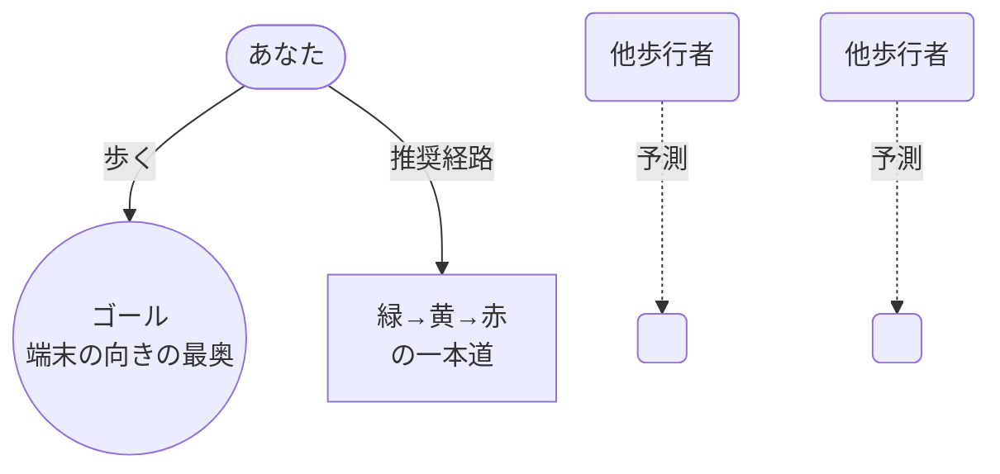
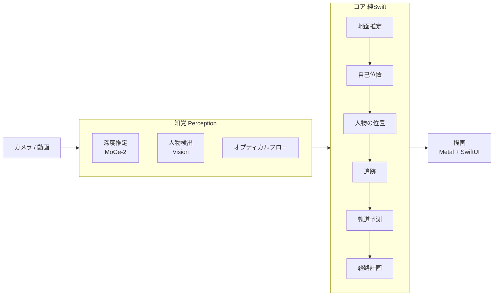

# route-dance

カメラ映像から周囲の歩行者の動きを予測し **ぶつからずに歩ける経路**を映像に重ねて示す iOS ARアプリ

すべての処理をデバイス上で完結 &nbsp;·&nbsp; iOS 27 / macOS 27

<!--
発表時間 約5分。まずは「何をするアプリか」を一言で。
自動運転車の実験映像のように、リアルタイム映像の上に「歩くべき一本の道」を重ねるイメージ、と伝える。
📸 スクリーンショット差し込み予定: 背景に実機アプリ画面（経路オーバーレイ）を薄く敷くと映える。
-->

---
layout: two-cols
layoutClass: gap-10
---

# 何を解くのか

人混みの中で、**他の歩行者とぶつからずに歩ける経路**を考えるのは地味に難しい。

- 相手がどう動くかを読む
- 自分の速度で間に合うか判断する
- どっちに避けるか決める

route-dance は、これをカメラ映像の上で**リアルタイムに可視化**する。

::right::

緑=今の速度で通れる / 黄・赤=減速が必要

<!--
「歩きスマホ」前提のデモアプリである点、安全性は別途検討課題である点を一言添える。
-->

---

# 使い方のイメージ

📱

映像に道を重ねる

地面の上に、今の歩行速度で約5秒先までたどれる一本の経路を描く

🧭

コンパス型の矢印

進むべき向きを360°の矢印で示す

🎥

動画でも同じ

撮り溜めた普通の動画に、ライブと同じUIを重ねて検証できる

ゴール（v1）は「端末が向いている方向の、地面上で見える一番奥の点」。将来は地図で目的地を指定できるようにする。

---
layout: two-cols
layoutClass: gap-8
---

# はじめに：対象デバイス

メインは **iPhone アプリ** です 📱

**でも、なぜ macOS でも動くの？**

アプリを **2つ** 作ったからです。

UI もアルゴリズムも共有。違うのは「どこで動かすか」だけ。

::right::

### macOS 版 = デバッグ専用の双子
- UI・アルゴリズムは iPhone 版と**共有**
- 動画ファイルを流して動作を確認できる
- つまり、**動作はスマホ版とほぼ同じ**

⚠️ 端末の性能が違うので、速度や発熱は少し変わる。 
「正しく動くか」は Mac で、「実機でどうか」は iPhone で確かめる。

<!--
開発を速く回すための工夫。Macなら動画を繰り返し流してアルゴリズムを詰められる。
コアは純SwiftなのでテストもMacでOK。
-->

---
layout: center
---

# どう動いているのか

カメラ1本の映像だけで、空間認識から経路計画までをデバイス上で完結させる

コア（地面・自己位置・追跡・予測・計画）は純Swift。外部依存ゼロ、<code>swift test</code> でヘッドレス検証できる。

<!--
ここが全体像。以降のスライドはこのパイプラインの各ブロックを掘り下げる、と予告する。
-->

---

# 使っているアルゴリズム 一覧

| アルゴリズム | どんなもの | どこで使う |
| --- | --- | --- |
| **単眼メトリック深度**（MoGe-2） | 1枚の画像から深度・点群・画角を推定するNN | 空間を「画像だけ」で測る起点 |
| **RANSAC 平面当てはめ** | 外れ値に強い平面推定 | 点群から地面を見つける |
| **オプティカルフロー**（Lucas-Kanade） | 画素の動きを追う | 自分の移動（自己位置）の推定 |
| **SE(2) 剛体変換の推定** | 俯瞰での回転+並進を最小二乗 | 自己位置オドメトリ |
| **人物検出**（Vision） | 画像中の人の矩形を出すOS標準API | 他歩行者を見つける |
| **カルマンフィルタ** | 位置・速度の時系列推定 | 各歩行者の追跡 |
| **ByteTrack + ハンガリアン法** | 検出と既存トラックの対応付け | 複数人の追跡（MOT） |
| **等速度モデル(CVM) + 多峰サンプル** | 速度で外挿し、ばらつきを広げる | 他歩行者の軌道予測 |
| **CPA（最接近時刻）** | 相対速度から衝突の近さを測る | 何秒先まで予測するか |
| **サンプリング型経路探索** | 候補を多数生成し評価 | 推奨経路を選ぶ |
| **ST-graph 上の動的計画法** | 経路に沿った速度を最適化 | 減速区間（黄・赤）の決定 |

<!--
この表は「地図」。次からの技術スライドはこの中の主要なものを掘り下げる。
NNはMoGe-2と(将来の)予測モデルだけ。残りは古典的な幾何・最適化で、純Swiftで自前実装している点を強調。
-->

---
layout: two-cols
layoutClass: gap-8
---

# 技術① 空間を「画像だけ」で測る

LiDARやARKitは使わず、**単眼メトリック深度**を主軸にした。

**MoGe-2 ViT-S** (MIT, 35M) を Core ML 化

- 1枚の画像から **点群・深度・カメラ画角** を推定
- 画角も出すので、内部パラメータ不明の動画でも動く
- M4 Pro の ANE で **約37ms** / iPhone 15 Pro 推定 約55ms

::right::

**なぜ画像だけ？**

ライブ映像と、撮り溜めた普通の動画が **まったく同じ処理経路**を通る。

→ 動画での評価結果が、そのまま ライブの性能になる。

深度の絶対スケール誤差は、地面から得たカメラ高さで補正して安定させる。

<!--
深度モデルの選定はライセンス(MIT)・サイズ・画角推定の有無で決めた、と補足。
-->

---

# 技術② 地面と自分の動きを推定する

### 地面平面
深度の点群から **RANSAC** で地面を当てはめる

- カメラの高さと傾きが得られる
- ライブでは CoreMotion の重力で補正
- カメラ高さを平滑化して深度スケールを安定化

### 自己位置（画像オドメトリ）
地面上の点を **オプティカルフロー**で追い、俯瞰座標で SE(2) を推定

- 自前のピラミッド型 Lucas-Kanade
- 他歩行者の枠内は除外（自分の動きと誤認しない）
- ライブではジャイロと融合

歩行速度はこの並進を1〜1.5秒の窓で平滑化して求める。

---
layout: two-cols
layoutClass: gap-8
---

# 技術③ 人を見つけて追う

### 検出
**Vision** の人物矩形検出（OS標準・iOS/macOS共通）

### 地面上の位置
- 足元レイと地面の交点
- 深度の中央値
- 身長の事前分布（足元が切れたとき）

→ 各手法を**分散で重み付け**して統合

::right::

### 追跡（MOT）
**ByteTrack方式を自前Swift実装**

- 地面座標の等速カルマンフィルタ
- 毎フレーム自己位置の変化で全トラックを補正
- 2段階マッチング + ハンガリアン法

追跡の状態は<strong>地面座標</strong>で持つ。 
画面上ではなく実空間で「どこに誰がいるか」を追う。

---

# 何を「障害物」として扱うか

### 障害物 = 他の歩行者
いま避ける対象は**動く人**に絞っている。

- 各歩行者を**地面座標の点＋半径**で表す （体の半径 + パーソナルスペース ≒ 0.6m）
- 止まっている物・壁などは v1 では扱わない

将来は地面として通れない領域（段差・車道など）への拡張余地あり。

### 処理の工夫
- **未来の位置**を障害物にする 今いる場所でなく、予測軌道で避ける
- **確率として扱う** 1点でなくサンプル軌道の集合 → 衝突「確率」で評価
- **相手は避けてくれない前提**（安全側に倒す）
- **近い人ほど重視**（CPA で予測を長くとる）
- **自分の動きと分離** 人物の枠内はオドメトリから除外

ポイント: 障害物は「今その場にいる人」ではなく「<strong>これから数秒間に人がいそうな時空間の領域</strong>」として扱う。

<!--
時刻付きの占有として扱うのが肝。ユーザーがそのセルに到達する時刻に、そこに誰かがいる確率で危険度を測る。
-->

---

# 画面の見かた（デバッグ詳細表示）

デバッグモード（デフォルトON）では、各処理が正しく動いているかを一目で確認できる。映像は白っぽく加工してオーバーレイを見やすくする。

<b>検出枠</b> … Vision が見つけた人物。枠の上に<b>トラックID</b>と<b>距離</b>

<b>予測経路</b> … 各歩行者が今後とりそうな<b>サンプル軌道</b>の線（K本）

<b>推奨経路</b> … 緑=今の速度で通れる / 黄・赤=減速が必要

<b>候補経路</b> … 探索した経路群を薄く表示（P_safe の色）

<b>ヒートマップ</b> … 地面の各点に「そこへ行くとぶつかる確率」を色で

<b>地面平面</b> … RANSAC で推定した地面グリッド

🧭

<b>コンパス矢印</b> … 進むべき向き（360°回転）

⊕

<b>ゴール</b> … 端末の向きの、地面上で見える最も奥の点

<b>上部の HUD</b>: 歩行速度 / FPS / 検出数 / 追跡数 / 各処理の時間 / 自己位置の状態 / カメラ高さ / 入力ソース

<!--
📸 スクリーンショット差し込み予定: 実際のデバッグ画面を右側か背景に置き、各要素から引き出し線を引けると理想。
まずは凡例だけでも、画面を見せたときに「どれが何か」が伝わる。
-->

---

# （デモ）実際の表示

📸 **スクリーンショット差し込み予定**

ここに iPhone 実機（またはMacで動画再生）の画面を貼る： 
映像の上に推奨経路（緑→黄→赤）・コンパス矢印・HUD が重なった様子

デバッグモードON（予測経路・衝突確率ヒートマップ・検出枠）版と、通常版の2枚あると良い

<!--
デモ動画を流せるなら、ここで実機またはMacの画面を見せる。静止画が難しければ動画キャプチャでも可。
-->

---
layout: two-cols
layoutClass: gap-8
---

# 技術④ 動きを予測する

**等速度モデル(CVM) + 多峰サンプル**（Phase 1）

- 追跡で得た速度で外挿
- 不確かさは時間とともに広げる
- 向き・速さを摂動した **K本のサンプル軌道**
- 出力は「重み付きサンプル軌道の集合」に統一
  → 後段が予測器に依存しない

学習モデル（EqMotion等）はPhase 2で同じ基盤で比較予定。単純な場面ではCVMが深層モデルと同等以上という研究もある。

::right::

### 何秒先まで予測する？
**最接近時刻(CPA)ベースの可変ホライズン**

$$t_{cpa} = \max\left(0,\ -\frac{p \cdot v}{|v|^2}\right)$$

$$N = \mathrm{clamp}(t_{cpa} + \tau,\ N_{min},\ N_{max})$$

近づいてくる人は短く、関係ない人は長く。 
「距離÷速度」だと同方向の人に短すぎ・停止時に発散する問題を回避。

---

# 技術⑤ 経路を決めて、色で示す

### 経路の探索
歩行速度は固定し、**向き（曲率）の列だけ**を探索

- 約5秒先までの候補を数百本生成
- 各候補 × 各歩行者のサンプル軌道で **衝突しない確率** $P_{safe}$ を評価
- ゴールへの近さ・前回との差も加味

### 減速区間の表示
避けきれない所は **ST-graph 上のDP** で速度プロファイルを求める

緑 = 今の速度で通れる

黄 = 少し減速
赤 = 大きく減速

自動運転のパス-速度分解と同じ考え方。

---
layout: center
class: text-center
---

# 設計の背骨

🔒

オンデバイス完結

推論も計算もすべて端末内。ネットワーク通信なし

🔁

ライブ = 動画

画像だけで空間認識するから、ライブと動画が同一パイプライン

🧩

依存ゼロ

Apple純正 + 自前実装のみ。コアは純Swiftで差し替え可能

Mac でも同じUI・同じアルゴリズムで動画を流して検証できる。

---
layout: two-cols
layoutClass: gap-8
---

# 現状と今後

### できていること
- コアアルゴリズム（`swift test` が通る）
- MoGe-2 の Core ML 化（ANEで約37ms）
- HUD・ドロワー・コンパス・オーバーレイのUI
- 検出→追跡→予測→計画→描画 の接続
- iOSライブカメラ / 写真動画（実装済み）

::right::

### これから
- 実写の歩行動画でパラメータ調整
- **iPhone実機での検証**（速度・精度・発熱）
- 予測・追跡の評価（ADE/FDE など）
- 学習型予測器との比較（Phase 2）
- 地図による目的地指定

※ 開発進行中。構成・数値は変わる可能性があります。

---
layout: center
class: text-center
---

# まとめ

カメラ1本の映像から、 
**周囲の歩行者を予測し、ぶつからない道を重ねて示す** iOSアプリ。

画像だけで空間を測る（単眼深度）

CPAで予測、確率で計画

すべてオンデバイス

ライブと動画が同じ処理

ありがとうございました

